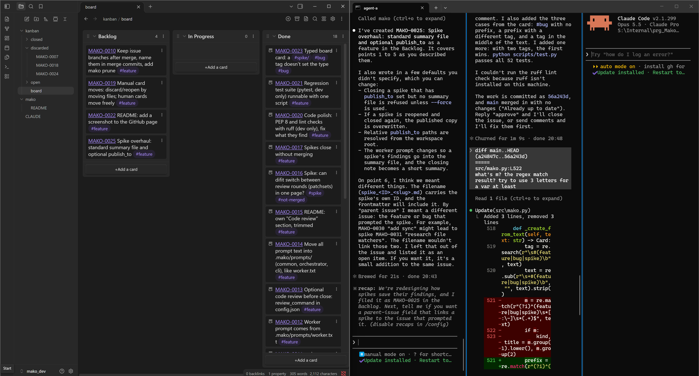

# Mako

Multi-Agent Kanban for Obsidian: a quick start for running several Claude Code agents on one project.
You get a kanban board you view and edit in Obsidian, a git repo, one permanent git worktree per agent
slot, issue claiming with locks, and an MCP server so agents can claim, work on and close issues
themselves.



## Install

Open PowerShell in an empty folder that will become the workspace, and run:

```powershell
irm https://raw.githubusercontent.com/xwize/mako/main/install.ps1 | iex
```

On Linux, open a terminal in an empty folder and run:

```sh
curl -fsSL https://raw.githubusercontent.com/xwize/mako/main/install.sh | bash
```

Either one asks for a project name. To pass it (and other options) on the command line instead, use:

```powershell
& ([scriptblock]::Create((irm https://raw.githubusercontent.com/xwize/mako/main/install.ps1))) -Project myproj
```

On Linux, pass options with `bash -s --` (or download `install.sh` and run it directly):

```sh
curl -fsSL https://raw.githubusercontent.com/xwize/mako/main/install.sh | bash -s -- --project myproj
```

`irm | iex` can't take arguments, which is why the second form exists. Neither form runs a script
file, so the execution policy doesn't block them and you don't need to change it. Both work in
Windows PowerShell 5.1 and PowerShell 7. On an old Windows PowerShell 5.1 that fails to download
with a TLS or "could not create SSL/TLS secure channel" error, run this first in the same window:

```powershell
[Net.ServicePointManager]::SecurityProtocol = [Net.ServicePointManager]::SecurityProtocol -bor 'Tls12'
```

### Options

PowerShell flags are on the left, the Linux `install.sh` equivalents on the right.

| Option | Meaning |
| --- | --- |
| `-Project <name>` / `--project <name>` | Project folder and git repo name. Issue ids use it as their prefix: `myproj` gives `MYPROJ-0001`. |
| `-Prefix <LETTERS>` / `--prefix <LETTERS>` | Issue id prefix, if you want a different one. |
| `-Agents a,b,c` / `--agents a,b,c` | Worker slot names (default `agent-a,agent-b`). |
| `-Base <branch>` / `--base <branch>` | Base branch (default `main`). |
| `-Ref <branch-or-tag>` / `--ref <branch-or-tag>` | Mako version to install (default `main`). Use a release tag such as `-Ref v0.1.0` to pin. |
| `-Repo <url-or-path>` / `--repo <url-or-path>` | Where to get Mako from (default this GitHub repo). A local clone works, for testing. |
| `-Upgrade` / `--upgrade` | The folder is already a workspace: install the downloaded Mako into it. |
| `-Force` / `--force` | Don't ask before setting up in a folder that isn't empty. |
| `--path` | Linux only. Also install `~/.local/bin/mako`, a shim that runs the Mako of the workspace you are in (it errors cleanly outside one). Put `~/.local/bin` on your PATH. |

The installer installs `main` by default. There are no release tags yet. Once there are, `-Ref`
pins to one.

### Prerequisites

- **Python 3.8 or newer** as `python` on PATH. Mako is a single standard-library Python file,
  and everything it generates runs `python`, so `py -3` alone isn't enough. A `python` that opens
  the Microsoft Store is only a stub. Install from [python.org](https://www.python.org/downloads/)
  and tick *Add python.exe to PATH*.
- **git** ([Git for Windows](https://git-scm.com/download/win)).
- **Linux**: Python 3 and git (2.30 or newer is best), from your package manager. Optional, for the launcher: `konsole`, `gnome-terminal` or `tmux`, and **Claude Code**. No root, no shell profile edits; use `./mako.sh` and `./mako.launch.sh` afterwards.
- Optional on Windows, needed by the launcher: **Windows Terminal** (`wt`) and **Claude Code** (`claude`). The
  installer warns if they're missing but still finishes.

It needs no admin rights and doesn't touch your global PATH. The `mako` shims are put on PATH only
inside the agent panes.

### What it does

1. Checks the prerequisites and stops with a message if Python 3 or git is missing.
2. Shallow-clones Mako (`-Ref`) into a temp folder.
3. Runs `python src/mako.py init <project>` in the current folder.
4. Deletes the temp folder and prints the next steps.

It is safe to run twice. In a folder that already has `.mako/config.json` it stops and changes
nothing, unless you pass `-Upgrade`. An upgrade replaces Mako's code and generated files but never
touches your cards, config or repo history.

### What you get

```
<workspace>/                     open this folder as an Obsidian vault
  CLAUDE.md                      your project's instructions for Claude
  kanban/board.md                the board (Obsidian Kanban plugin)
  kanban/open/, kanban/closed/   one card per issue
  kanban/discarded/              issues dropped with `mako discard` (off the board; `mako reopen` undoes)
  <project>/                     your git repo, on the base branch
  mako.cmd                       the CLI:  .\mako.cmd new feature "title"
  mako.launch.bat                Windows Terminal: orchestrator + one pane per slot
  .obsidian/                     Kanban and Advanced Exclude plugins, pre-enabled
  .mako/                         Mako itself: code, config, locks, slot worktrees
  .mako/prompts/                 everything agents are told; yours to edit (see below)
```

### Editing what agents are told

Each agent's guide (the `mako` MCP server's instructions, also `mako guide`) is built fresh from
the files in `.mako/prompts/`:

| File | Part |
| --- | --- |
| `common.txt` | top of every guide: the workspace and the rules |
| `worker.txt` | a worker slot's role and how to finish an issue |
| `orchestrator.txt` | the orchestrator's role |
| `review.txt` | the code review steps, shown to workers only when `review_command` is set |
| `cli.txt` | the CLI list at the end of every guide |
| `claude-pointer.txt` | the line `mako init` puts at the top of a new workspace's `CLAUDE.md` |

They can use `{root}`, `{project}`, `{base}`, `{prefix}`, `{agent}`, `{agents}` and `{worktree}`;
other braces are left as they are. A deleted file shows a "missing" message in its place, and
`mako init` restores it. On an upgrade, a file you haven't changed follows the new default; one
you have edited is kept, with a note pointing at the new default in `.mako/templates/prompts/`.

### Next steps

1. Open the folder as a vault in Obsidian (*Open folder as vault*) and trust it, so the Kanban plugin
   loads. Open `kanban/board.md`.
2. Make a first issue: `.\mako.cmd new feature "My first feature"`.
3. Run `.\mako.launch.bat`. The orchestrator opens on the left and the worker slots on the right.
   Ask a worker to "pick up MYPROJ-0001".
4. Closed the terminal? `.\mako.cmd resume` reopens the same layout with every pane continuing its
   last Claude conversation (`claude -c`); a pane with no earlier conversation starts fresh.
   `mako resume <slot|orchestrator>` reopens just one tab.

Each pane's Claude session is named `<project>-<slot>-<tag>` (for example `myproj-agent-a-3f9c`), so
sessions of different Mako workspaces on one machine can't be mixed up when one session messages
another. The 4-hex `session_tag` is made by `mako init`, kept in `.mako/config.json` and never
changed; `mako session-name <slot>` prints a name.

## Your own tasks

Mark a card as yours with `mako new feature "Set up the API key" --human`, `mako edit <ID> --human`,
or by typing it on the board with a `#human` tag. Human cards are a plain kanban: drag them to any
column, with no locks, branches or merges, and agents can't claim or close them. An agent issue can
depend on one; it unblocks when you move it to Done.

## Approving issues a worker creates

Issues you or the orchestrator create can be claimed straight away. An issue a worker slot creates
starts with `approved: false` and shows `[unapproved]` in `mako list`; no agent can claim it until
you set `approved: true` in the card's properties.

## Merging into a feature branch

By default closing merges an issue into the base branch. Give a card a `merge_to` branch to merge it
there instead: `mako new feature "Login" --merge-to feature/auth`, or `mako edit <ID> --merge-to ..`
while it is in the Backlog (`''` clears). The branch is created from the base branch if it doesn't
exist. Workers still merge the base branch into their issue branch before closing, and the main
checkout is left on the base branch, so switch to `merge_to` yourself to try the result. Not for spikes.

## Spikes

A spike is research or a prototype: it never merges, and closing keeps its branch. Its result is
a summary file. When a worker claims a spike, Mako commits `.mako_spikes/spike_<ID>_<slug>.md` on
the spike's branch, with frontmatter (`id`, `title`, `agent`, `created`, `branch`, `closed`)
filled in. The worker writes the findings in its body and commits, and closing fills in `closed`.

To get the summary off the branch, give the spike a `publish_to` folder:
`mako new spike "Try caching" --publish-to docs/spikes`, or later with
`mako edit <ID> --publish-to ..`, which also works while the spike is In Progress. Closing then
copies the summary to `<publish_to>/spike_<ID>_<slug>.md`. A relative folder is taken from the
workspace root. It's a plain copy, never committed, and a re-close after `mako reopen` overwrites
it. A spike with `publish_to` but no summary on its branch can't be closed, except with
`mako close <ID> --force`.

`"spike_publish_to"` in `.mako/config.json` fills in `publish_to` on new spikes. Leave it empty
(`""`, the default) for none.

## Code review

Mako can stop each issue for your review before it merges. Set `review_command` in
`.mako/config.json` to the tool to open, for example [difit](https://github.com/yoshiko-pg/difit):

```json
"review_command": "npx difit HEAD {base}"
```

When a worker's branch is ready, it opens the review and waits. Reply "approve" in its pane, or
paste your comments and it fixes them and asks again. Nothing merges until the latest commits
have been reviewed. Leave it empty (`""`, the default) to turn review off.

The command can use `{base}`, `{branch}`, `{id}` and `{worktree}`. Its output goes to
`.mako/logs/<ID>.review.log`, and `mako review <ID>` reopens it.

### Reviewing in Gerrit (optional)

Instead of a review command, Mako can send each issue to a [Gerrit](https://www.gerritcodereview.com/)
you run yourself. You get patch sets, inline comments and votes, and agents read your comments
themselves instead of you pasting them. Add a `review` block to `.mako/config.json` (it wins over
`review_command`):

```json
"review": {"backend": "gerrit", "url": "http://127.0.0.1:8080", "project": "demo"}
```

`url` defaults to `http://127.0.0.1:8080` and `project` to the workspace's project name.

Mako itself knows nothing about Gerrit. `"backend": "gerrit"` loads
`.mako/templates/review/gerrit.py`, and Mako calls its hooks: `setup`, `request` (for
`request_review`), `status` (for `review_status`) and `finish` (after close, release or discard).
The hooks are described at the top of `mako.py`.

**You supply the Gerrit; Mako doesn't start, stop or install anything.** The reference setup is
trayit, a tray tool that runs the official `gerritcodereview/gerrit` image in Docker under WSL
on port 8080. Any Gerrit will do if it is:

- **in dev-auth mode** (`DEVELOPMENT_BECOME_ANY_ACCOUNT`, the official image's default). Mako
  creates its accounts by signing in as them, with no passwords to set up; setup refuses any
  other mode.
- **reachable only from your machine.** Dev auth lets anyone who can reach the port act as any
  account, administrator included, so bind it to `127.0.0.1` and never expose it on a network.

How it works:

- `mako review setup` creates the project, pushes the base branch and adds the accounts: `human`
  (you, an administrator) and one per agent slot. It is safe to re-run, and `request_review` runs
  it for you when needed, including after the Gerrit has been reset.
- Each issue is one change. Every `request_review` uploads the branch, squashed, as a new patch
  set. The reply gives two links: the change itself, which opens as whoever your browser is
  already signed in as, and a sign-in link, which uses dev auth to sign you in as `human` (no
  password) and then opens the change. Use the sign-in link so your comments and votes are `human`'s.
- When you've left comments, tell the agent. It calls `review_status` to read them, addresses
  them and asks for review again. You approve in the agent's pane by replying "approve".
- Gerrit never merges. Closing merges the branch as usual and abandons the change. Release and
  discard abandon the change too.
- To keep each change's history, set `"review_transcripts_to"` in `.mako/config.json` to a
  folder (relative to the workspace root, created if needed, never under `kanban/`). Closing then
  saves it as `<folder>/review_<ID>.md`. It's empty by default, which keeps nothing.
- If the Gerrit is down, `request_review` says so; close, release and discard still work.

The account tokens live in `.mako/review/gerrit/credentials.json`, and only Mako's tools call
Gerrit. Per-slot accounts give *attribution*, not *enforcement*: an agent that read that file could
act as any account.

## Reminding you to /clear

A long conversation costs tokens on every turn. When a worker closes an issue that was open for
more than `warn_after_minutes` (default 30) or reviewed more than `warn_after_reviews` times
(default 2), its next claim is refused once, and it asks you to run `/clear` or `/compact` in its
pane and then ask again. It is a nudge: the retry always works, cleared or not. Set a value to `0`
to turn that test off; both `0` means no reminders. The flag lives in `.mako/warn/<slot>`.

## Keeping issue branches

By default, closing an issue merges its branch into the base branch and deletes it. To keep the
branches, set `keep_branches` in `.mako/config.json`:

```json
"keep_branches": true
```

Closing then keeps the local branch and names it in the merge commit, for example
`Merge feature/MYPROJ-0005-login (MYPROJ-0005): Login`. Reopening and claiming such an issue
resumes its old branch; the worker merges the base branch into it before closing again.

`mako prune` deletes the kept branches of Done issues, whatever the setting. It uses
`git branch -d`, so only fully merged branches go; a spike's unmerged branch is skipped. It never
touches a Backlog or In Progress issue's branch, the base branch or a branch checked out in a
worktree.

- `mako prune --dry-run` lists what would be deleted.
- `mako prune <ID..>` prunes only those issues.
- `mako prune --discarded` also deletes the branches of discarded issues (`git branch -D`). Their
  work was never merged, so `--dry-run` shows how many commits each would lose.

## Development

Mako's code is `src/mako.py` (single file, standard library only) and `scripts/upgrade.py`. It
supports Python 3.8 and newer, so don't use newer syntax or library features. The tools below are
for developing Mako only; it doesn't need them to install or run.

### Running the tests

From the repo root, before committing:

```
python scripts/test.py
```

(`scripts\test.cmd` from cmd or PowerShell.) It runs ruff, then the regression tests in `tests/`
with pytest, and exits non-zero if anything fails. Extra arguments go to pytest, for example
`python scripts/test.py -k claim`. pytest comes from `pip install pytest`, or from `uvx pytest`
if [uv](https://docs.astral.sh/uv/) is installed. ruff is used if installed, or from uv's cache,
and skipped with a note otherwise.

The tests drive the real CLI and MCP server against a fresh workspace per test, in pytest's temp
folder, with the clock (`MAKO_NOW`) and git config fixed, so they never touch a real board and a
run gives the same result every time. `tests/helpers.py` has the helpers for acting as the user
(board drags, typed cards, hand edits) and as an agent (commits, MCP calls).

### Lint

`scripts/test.py` runs it, or on its own:

```
uvx ruff check --config dev/ruff.toml src scripts tests
```

It checks PEP 8 style and common bugs. Files only for developing Mako live in `dev/`, such as
`dev/ruff.toml` with its rules and why some are turned off.

ruff doesn't catch library features newer than 3.8 (it missed `Path.write_text(newline=)`, which
needs 3.10), so also try changes under 3.8, for example in a `testing/` deployment with
`uv run --no-project --python 3.8 python ../../src/mako.py ...`.
